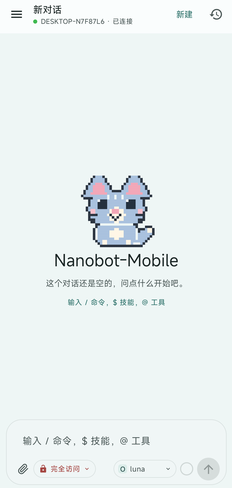
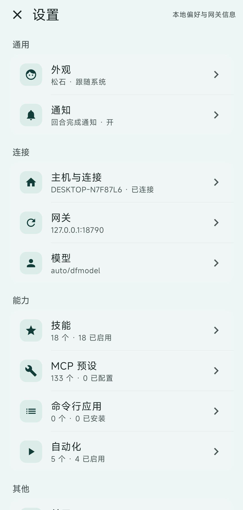
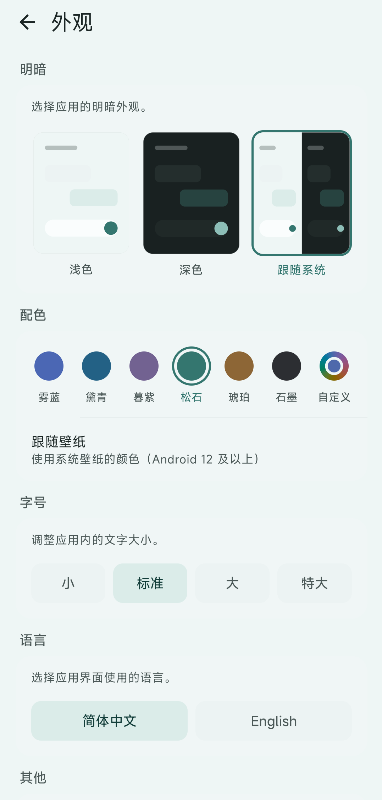
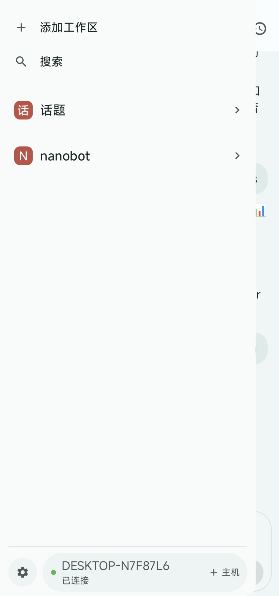
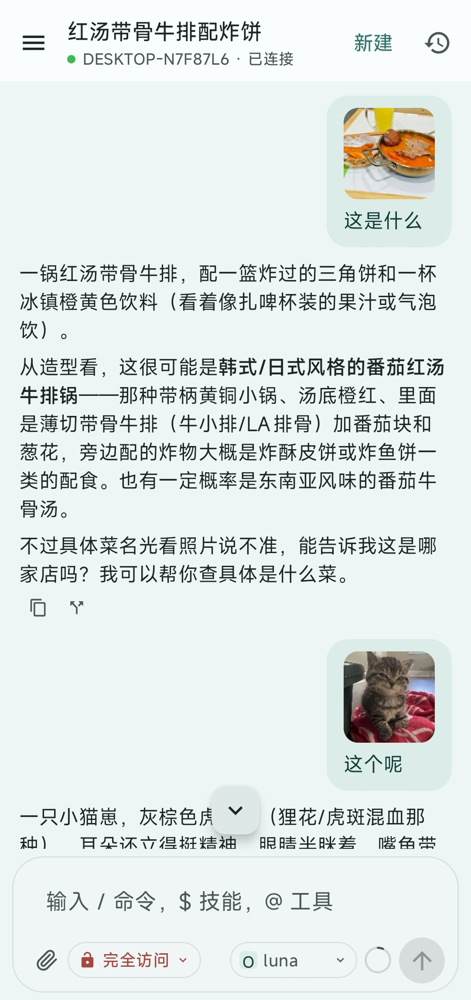
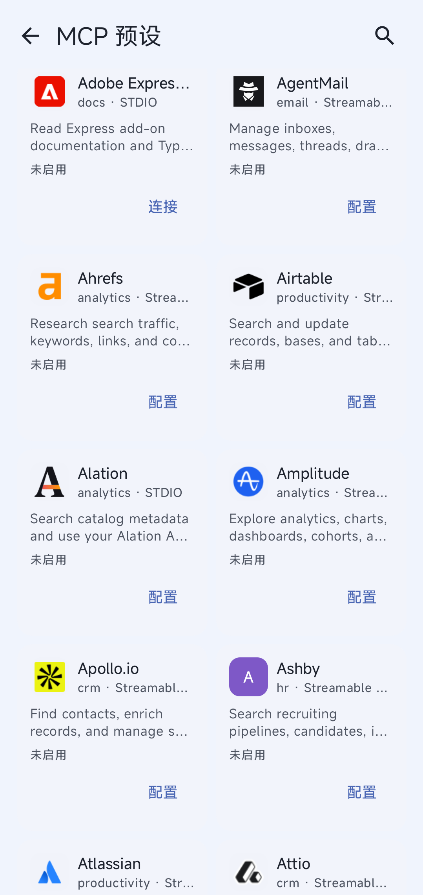

# Nanobot Mobile

A native Android client for a self-hosted [nanobot](https://github.com/HKUDS/nanobot) gateway.

nanobot keeps ownership of the agent: execution, tools, memory, and policy. This app is the
phone-side front end. It speaks the same public WebSocket and HTTP API as the bundled WebUI and
TUI, so it works against an unmodified gateway — no fork and no server-side plugin.

## Requirements

- Android 8.0 (API 26) or newer.
- A reachable nanobot gateway with the WebSocket channel enabled.
- `channels.websocket.tokenIssueSecret` set (or a static token).
- For access from outside your LAN: a relay and the `nanobot-link` program, or a VPN / port
  forward you manage yourself.

## Preview

<table>
  <tr>
    <td align="center"><br><sub>New chat</sub></td>
    <td align="center"><br><sub>Settings</sub></td>
    <td align="center"><br><sub>Appearance</sub></td>
  </tr>
  <tr>
    <td align="center"><br><sub>Workspaces</sub></td>
    <td align="center"><br><sub>Image chat</sub></td>
    <td align="center"><br><sub>MCP presets</sub></td>
  </tr>
</table>

## Quick Start

The default relay connects your phone to nanobot without opening an inbound port on your computer.
To use your own server instead, see [Self-host a relay](#self-host-a-relay).

### 1. Start the nanobot gateway

On the computer running nanobot, enable the WebSocket channel in `~/.nanobot/config.json` and set
a private secret. Merge these settings into your existing config:

```json
{
  "channels": {
    "websocket": {
      "enabled": true,
      "host": "127.0.0.1",
      "port": 8765,
      "tokenIssueSecret": "choose-a-private-secret",
      "websocketRequiresToken": true,
      "allowFrom": ["*"]
    }
  }
}
```

Start the gateway and keep it running:

```bash
nanobot gateway
```

### 2. Download and run nanobot-link

Download the Android APK and the `nanobot-link` binary for your computer from
[GitHub Releases](https://github.com/bingqilinweimaotai/Nanobot-Mobile/releases). Install the APK
on your phone, then **run `nanobot-link` on the same computer as the gateway**. For example, on Windows:

```powershell
.\nanobot-link-windows-amd64.exe
```

The release binary has a default relay address. `nanobot-link` reads the gateway port and secret
from your nanobot config, displays a pairing QR code and link, and opens a local pairing page. Keep
the program running while using the app. If a relay requires an admission key, set
`NANOBOT_RELAY_KEY` before starting it. If no release is available, see the
[APK build instructions](#build-and-test) and [link build instructions](relay-go/README.md#build).
A locally built link binary without a default relay requires
`--relay wss://your-relay.example.com/nanobot`.

### 3. Pair your phone

In the app, open the drawer, tap the host capsule at the bottom, and choose **Add host**. Scan the
QR code or paste the `nanobot://pair` link shown by `nanobot-link`.

The pairing link contains credentials. Treat it like a password and share it only with your phone.

### Alternative: connect over LAN or USB

For a phone on the same LAN, bind the gateway to `0.0.0.0` and keep authentication on:

```json
{
  "channels": {
    "websocket": {
      "enabled": true,
      "host": "0.0.0.0",
      "port": 8765,
      "tokenIssueSecret": "choose-a-private-secret",
      "websocketRequiresToken": true,
      "allowFrom": ["*"]
    }
  }
}
```

Use `http://10.0.2.2:8765` from the Android emulator. Use TLS (`wss`) for anything reachable from
outside your network. Cleartext HTTP is allowed for LAN development only.

**Same LAN** — add the host with the PC's LAN address, for example
`http://192.168.1.20:8765`, and the `tokenIssueSecret`.

**USB (no LAN or relay needed)** — use endpoint `http://127.0.0.1:8765` and forward the port:

```bash
adb reverse tcp:8765 tcp:8765
adb reverse --list
```

The rule is removed when the phone reconnects over USB, so re-run it after reconnecting. On a
machine with `adb` on `PATH`, `sh scripts/device-tunnel.sh 8765` does the same.

## Self-host a relay

Two Go programs in `relay-go/` make a gateway reachable without an inbound port. Neither requires
a change to nanobot:

1. **`nanobot-relay`** — a small public WebSocket server. It forwards opaque bytes and learns
   nothing about the traffic.
2. **`nanobot-link`** — runs on the PC next to nanobot. It connects *outbound* to the relay, reads
   the gateway port from the nanobot config, and prints a pairing link, a terminal QR code, and a
   local pairing page.

1. **Prepare a server.** Download the Linux relay binary from the release, or build it with
   `make build-linux` in `relay-go/`. Point a domain at the server and configure Caddy or nginx to
   terminate TLS and proxy requests to `127.0.0.1:8787`; see
   [`Caddyfile.example`](relay-go/Caddyfile.example). Allow HTTPS traffic to the proxy.
2. **Start the relay on the server.** Generate a private key, store it securely for later restarts,
   and use the same key for the link client:

   ```bash
   export RELAY_MODE=shared-key
   export RELAY_KEY="$(openssl rand -base64 32)"
   export RELAY_PATH=/nanobot
   export RELAY_PUBLIC_URL=wss://relay.example.com/nanobot
   ./nanobot-relay-linux-amd64 --listen 127.0.0.1:8787
   ```

3. **Connect from the nanobot computer.** Set `NANOBOT_RELAY_KEY` to the same key, then run the
   link binary with your relay URL. On Linux or macOS:

   ```bash
   export NANOBOT_RELAY_KEY='<same-relay-key>'
   ./nanobot-link --relay wss://relay.example.com/nanobot
   ```

   On Windows PowerShell, use `$env:NANOBOT_RELAY_KEY = '<same-relay-key>'` and run
   `.\nanobot-link-windows-amd64.exe --relay wss://relay.example.com/nanobot`. Scan the new QR
   code or paste its pairing link in the app. Keep the gateway, relay, and link program running.

For a local-only test, start the relay with `--mode open` instead. Never run an open relay on the
public internet; admission modes and the other deployment settings are covered in
[`relay-go/README.md`](relay-go/README.md).

`nanobot-link` reads `channels.websocket.port` and `channels.websocket.tokenIssueSecret` from
`~/.nanobot/config.json` (`--config` points elsewhere, `--port`/`--secret` override). Identity lives
in `~/.nanobot/link/state.json`; the first run imports the identity left by the older Kotlin agent
at `~/.nanobot/android/agent.json`, and `--reset` rotates it and re-pairs every phone.

The app binds a random loopback port and points the regular gateway client at it, so every HTTP and
WebSocket call rides the tunnel without protocol changes. The tunnel uses relay protocol v2: one
control WebSocket plus one multiplexed data WebSocket per peer. Authentication travels inside the
first control frame, never in a URL, and the data channel presents a short-lived session id in the
`X-Nanobot-Session` header.

## Architecture

| Module | Responsibility |
|---|---|
| `:protocol` | Wire models, inbound event decoder, outbound frame builders, feature DTOs, thread parser |
| `:tunnel` | Pairing offer/link format, relay protocol v2 codec, AES-GCM frame crypto |
| `:gateway` | Bootstrap, WebSocket lifecycle, REST reads, attachment upload, mutations, reconnect |
| `:app` | Compose UI, repository/service, Room cache, host profiles, loopback relay tunnel |

`:protocol` and `:gateway` are pure JVM modules, so the protocol is testable without a device and
reusable by a future desktop client.

`relay-go/` is a separate Go module containing the two shipping binaries. It is not part of the
Gradle build; see [`relay-go/README.md`](relay-go/README.md) for the wire format and deployment.

### Runtime shape

```
NanobotApplication
  └─ GatewayRepository (one process-wide connection to the active host)
       ├─ NanobotGateway (bootstrap + WebSocket + REST)
       ├─ NanobotService (foreground service, turn notifications)
       └─ ChatViewModel (events → UI state, Room cache, drafts)
```

The foreground service and the UI share the same gateway, so a turn keeps streaming while the app
is in the background.

### Connection flow

1. `GET /webui/bootstrap` with `X-Nanobot-Auth: <secret>`.
2. Open `ws_url?token=<one-time token>&client_id=<install id>`.
3. Wait for `ready`; keep its `chat_id`, upload capability, and advertised capabilities.
4. On reconnect, bootstrap again (the WS token is single-use), connect, then `attach` the last chat.
5. Load the transcript with `GET /api/sessions/websocket:<chat_id>/webui-thread`.
6. Send `{"type":"message","chat_id":…,"content":…,"turn_id":…,"webui":true}` and wait for
   `message_accepted`.

The gateway does not replay missed WebSocket frames. Reconnect recovery is `attach` plus a fresh
transcript read, exactly like the WebUI.

## Build and test

Requirements: JDK 17, Android SDK 35, and Go 1.23 for the relay.

```bash
./gradlew :protocol:test :tunnel:test :gateway:test :app:testDebugUnitTest
./gradlew :app:assembleDebug
```

The debug APK is written to `app/build/outputs/apk/debug/app-debug.apk`. Create `local.properties`
if Gradle cannot find your SDK:

```properties
sdk.dir=/path/to/Android/sdk
```

Relay programs:

```bash
cd relay-go
go test ./...
go vet ./...
go test -race ./...   # needs cgo and a C compiler
```

GitHub Actions runs the Android tests, builds the APK, tests the Go module, cross-compiles
`nanobot-link` for all desktop platforms, and publishes release artifacts on `v*` tags.

## Security notes

- The token-issue secret is encrypted with an Android Keystore AES/GCM key.
- Do not embed a static gateway token in the APK. Use `tokenIssueSecret` and per-install bootstrap.
- `chat_id` is a capability, not an authorization boundary. Do not expose the gateway to untrusted
  users.
- The relay sees only ciphertext. The pair key is static for the life of a pairing, so a leaked
  pairing link can decrypt captured relay traffic. Rotate it with `nanobot-link --reset` and pair
  the phone again.
- Cleartext HTTP is allowed for LAN development. Use TLS for remote access.

## License and Acknowledgements

Nanobot Mobile is released under the [MIT License](LICENSE).

- [nanobot](https://github.com/HKUDS/nanobot) provides the gateway this app connects to.
- Parts of the UI design were inspired by [Paseo](https://github.com/getpaseo/paseo).
